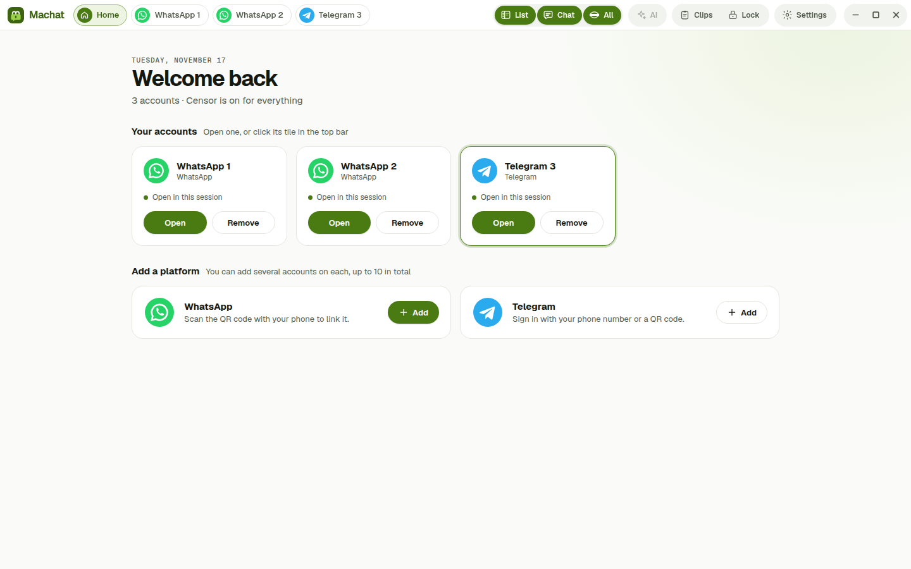
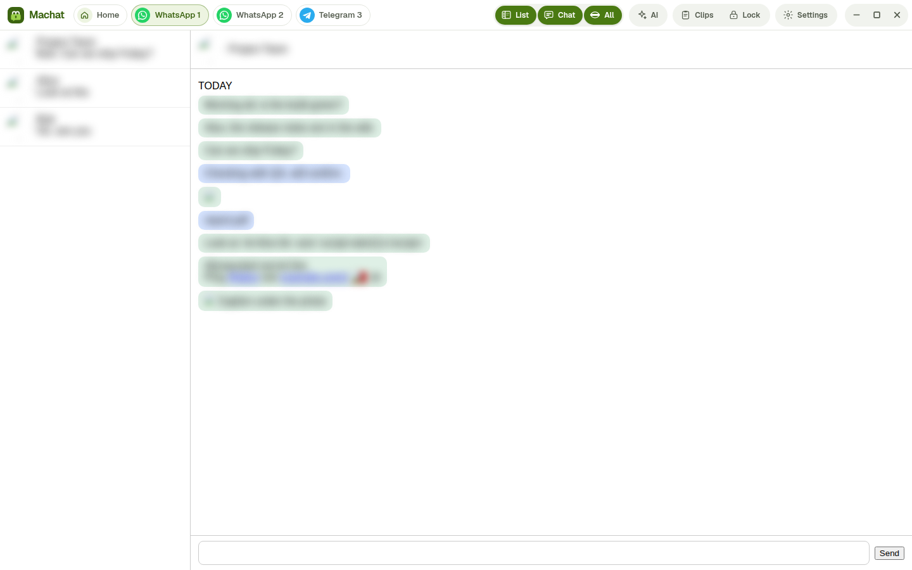
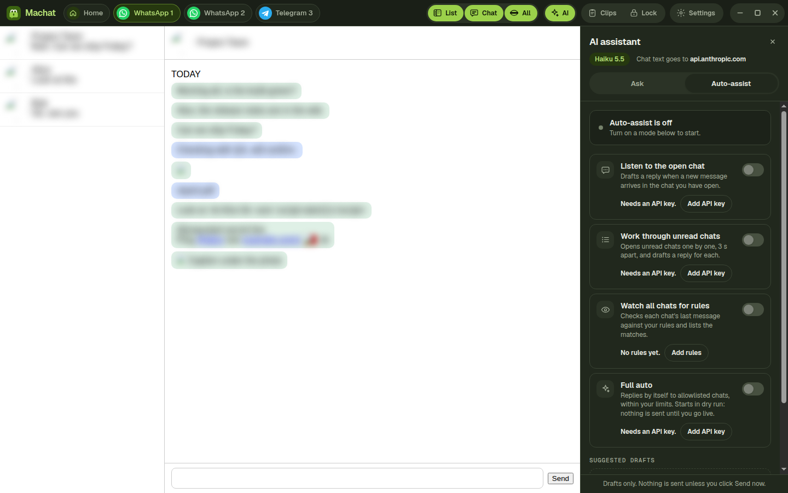
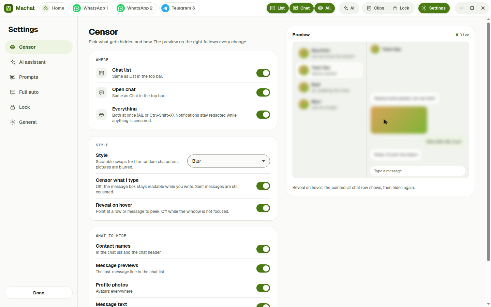
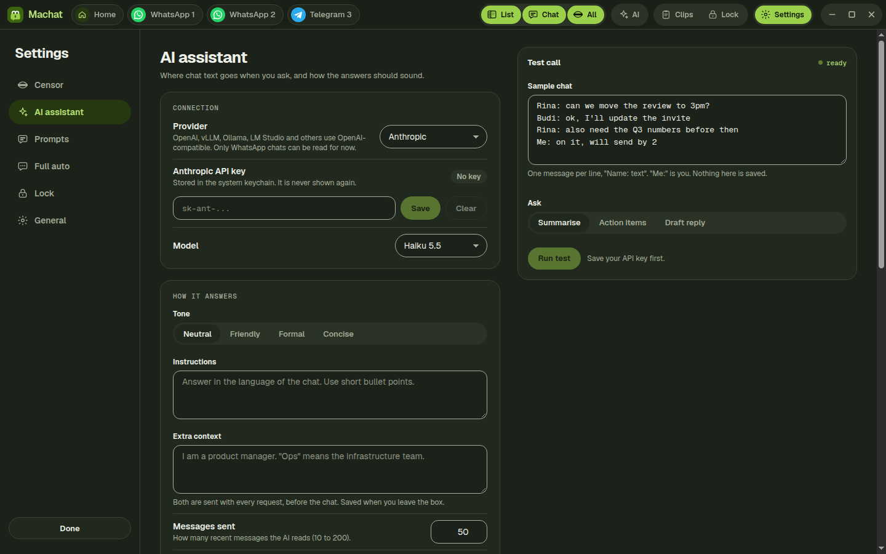
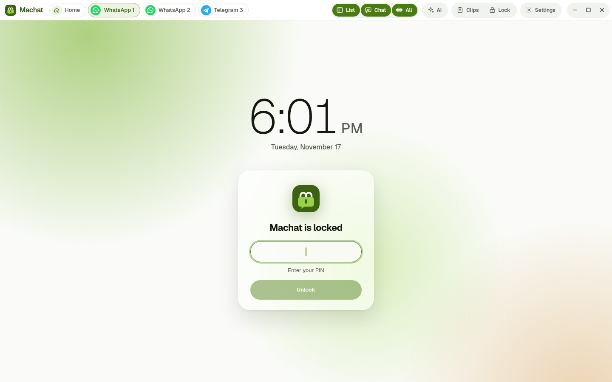
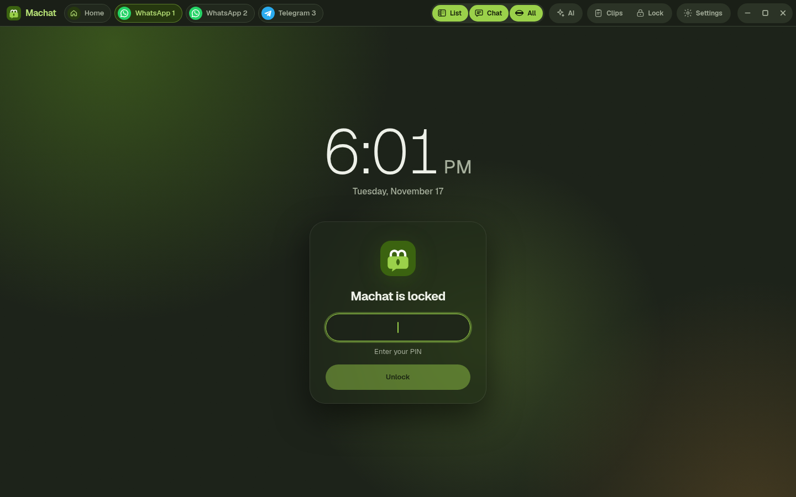

<p align="center">
  
</p>

<h1 align="center">Machat</h1>

<p align="center">
  A private, focused desktop workspace for your messaging accounts.
</p>

<p align="center">
  <a href="https://github.com/moeghifar/machat/releases/latest"></a>
  <a href="LICENSE"></a>
  
</p>

<p align="center">
  <a href="#download">Download</a> ·
  <a href="#features">Features</a> ·
  <a href="#screenshots">Screenshots</a> ·
  <a href="#build-from-source">Build</a> ·
  <a href="#license">License</a>
</p>

<p align="center">
  <picture>
    <source media="(prefers-color-scheme: dark)" srcset="docs/screenshots/home-dark.png">
    
  </picture>
</p>

---

## Purpose

Machat brings your WhatsApp and Telegram accounts into a single desktop window and adds what the web clients leave out:

- **Privacy on screen.** Hide names, messages and media while you share your screen, present, or work in public.
- **Protection at rest.** Lock the app behind a PIN or password when you step away.
- **Help when you reply.** An optional AI assistant reads the open chat and drafts replies in your tone. You decide what gets sent.

Machat is an independent project. It is not affiliated with, endorsed by, or sponsored by WhatsApp, Meta, or Telegram.

## Features

### Accounts
- WhatsApp and Telegram, with several accounts side by side
- A Home screen for adding, opening and removing accounts
- Each account runs in its own isolated session

### Privacy censor
- Choose where to censor: the chat list, the open chat, or everything
- Three styles: blur, solid block, or scramble
- Reveal on hover
- Choose which of five kinds of content to hide
- A live preview shows exactly what is hidden
- Notification text is redacted

### App lock
- PIN (4–12 digits) or password (8–128 characters)
- Stored as an argon2id hash in the system keychain, never as plaintext
- Auto-lock after 1–60 minutes in the background, or when the window is minimised

### AI assistant
- Works with Anthropic or any OpenAI-compatible API
- Tones: neutral, friendly, formal or concise
- Standing instructions and extra context
- Prompt templates you can edit as Markdown files
- Draft mode: the assistant suggests a reply and you send it with one click
- Full auto (optional): replies sent under guardrails, with an activity log
- A test call that checks your settings against a sample chat

### Productivity
- Clipboard history, kept in memory only, with one-click paste into the open chat
- Light and dark themes with a calm matcha palette
- Respects the system's reduced-motion setting
- Choose your download folder

## Screenshots

<table>
  <tr>
    <td width="50%">
      
      <p align="center"><b>Privacy censor</b><br><sub>Names, messages and media blurred while you share your screen.</sub></p>
    </td>
    <td width="50%">
      
      <p align="center"><b>AI assistant</b><br><sub>Draft replies, auto-assist modes and rule watching, next to the chat.</sub></p>
    </td>
  </tr>
  <tr>
    <td width="50%">
      
      <p align="center"><b>Censor settings</b><br><sub>Choose what to hide and how, with a live preview.</sub></p>
    </td>
    <td width="50%">
      
      <p align="center"><b>AI settings</b><br><sub>Provider, model, tone and a test call on a sample chat.</sub></p>
    </td>
  </tr>
  <tr>
    <td width="50%">
      
      <p align="center"><b>App lock</b><br><sub>PIN or password, with auto-lock in the background.</sub></p>
    </td>
    <td width="50%">
      
      <p align="center"><b>Light and dark</b><br><sub>Follows your system theme, or set it yourself.</sub></p>
    </td>
  </tr>
</table>

<sub>The screenshots use demo accounts and sample conversations.</sub>

## Download

Pre-built installers are on the [Releases](https://github.com/moeghifar/machat/releases/latest) page.

| Platform | Package |
|---|---|
| Windows | `Machat.Setup.<version>.exe` (installer) · `Machat.<version>.exe` (portable) |
| macOS (Apple Silicon) | `Machat-<version>-arm64.dmg` |
| macOS (Intel) | `Machat-<version>.dmg` |
| Linux | `Machat-<version>.AppImage` · `machat_<version>_amd64.deb` |

> Builds are not code-signed yet. On macOS, right-click the app and choose **Open** the first time. On Windows, choose **More info → Run anyway** in SmartScreen.

## Build from source

Requires Node.js 22 or later.

```sh
npm ci
npm start       # run in development
npm test        # run the test suite
npm run dist    # build installers for the current OS into release/
```

## Privacy

- Your messages stay between your computer and the messaging service.
- The AI assistant contacts only the API provider you configure, and only when you use it.
- Lock secrets are stored as hashes in your system keychain.
- Clipboard history is never written to disk.

## License

Copyright © 2026 moeghifar

Licensed under the **Apache License, Version 2.0** (the "License"). You may not use this project except in compliance with the License. A copy is in [LICENSE](LICENSE), and it is also available at <http://www.apache.org/licenses/LICENSE-2.0>.

Unless required by applicable law or agreed to in writing, software distributed under the License is distributed on an **"AS IS" BASIS, WITHOUT WARRANTIES OR CONDITIONS OF ANY KIND**, either express or implied. See the License for the specific language governing permissions and limitations under the License.

WhatsApp and Telegram are trademarks of their respective owners and are used here only to describe compatibility.
